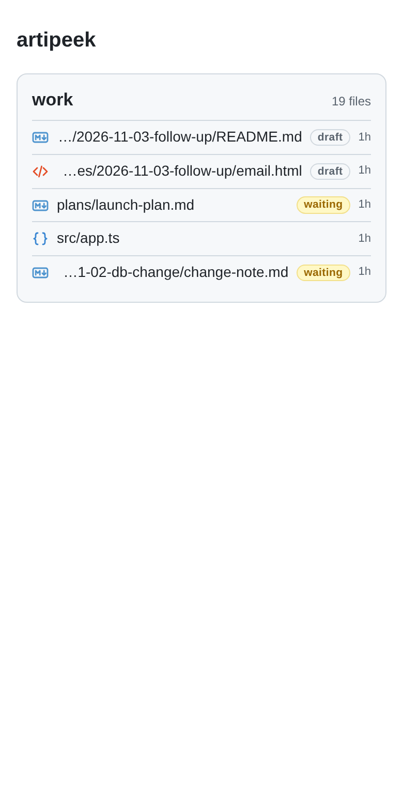
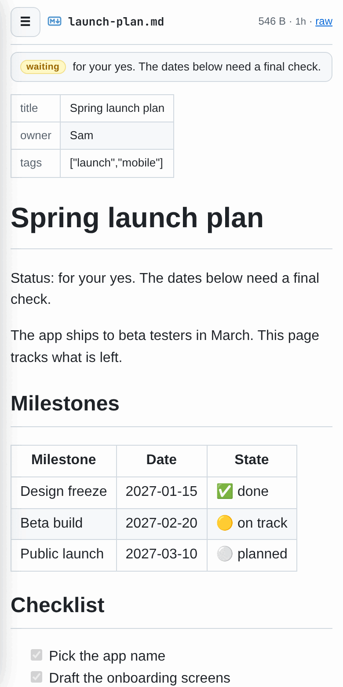
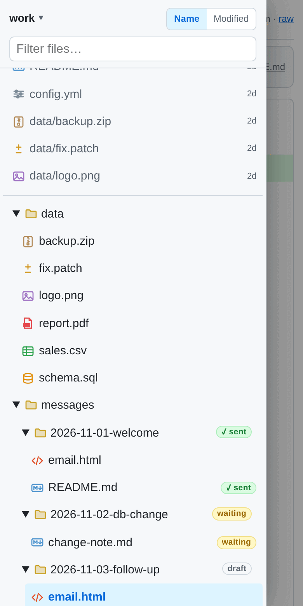
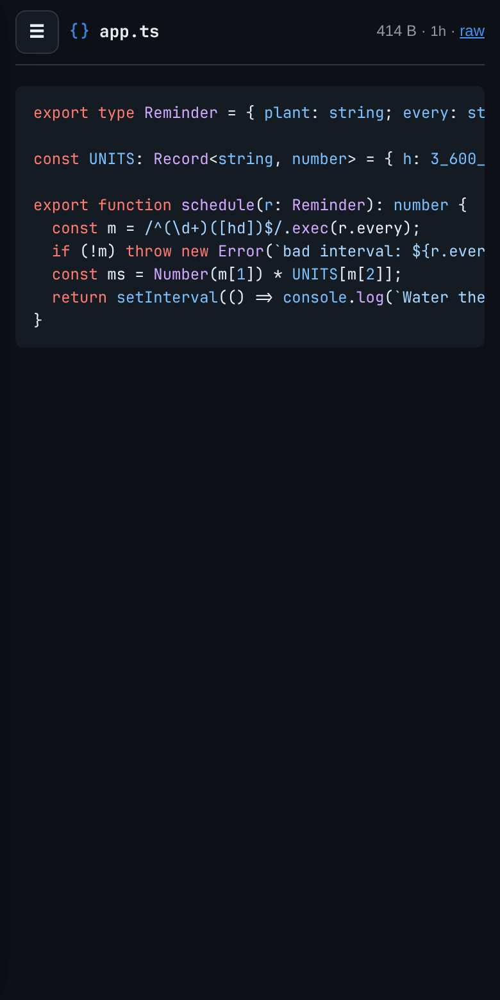
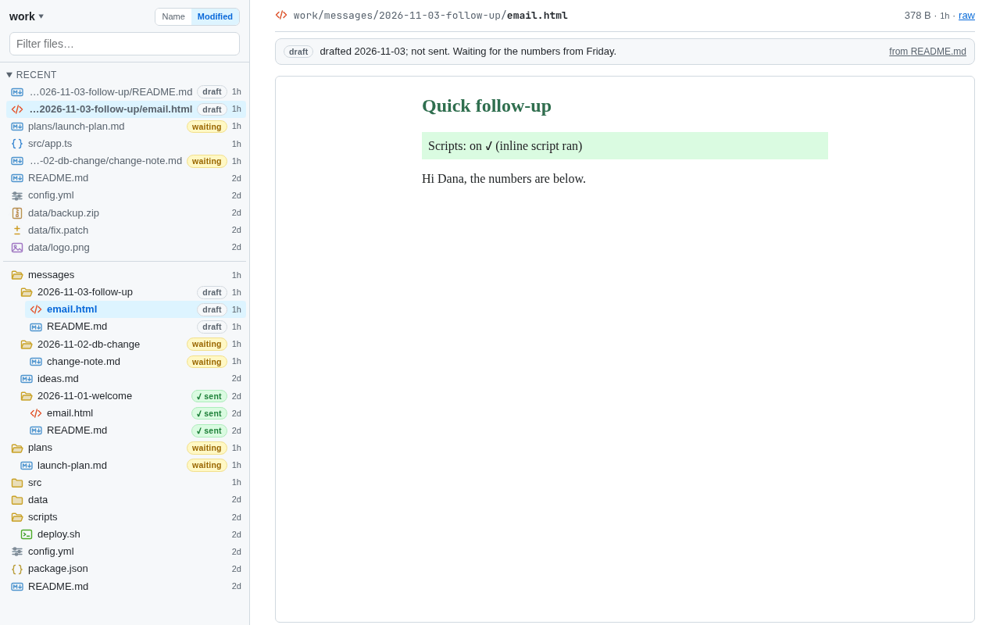

#  artipeek

Read files from chosen folders (repos) in a browser, mainly on the phone, while agents write them. It is read-only and live: when a file changes, the open page updates by itself.

Built with [Bun](https://bun.sh). One server file, no build step, no client framework.

<p>
  
  
  
  
</p>



<sub>Screenshots use made-up demo folders.</sub>

## Open it

- On the machine: **http://127.0.0.1:4321**
- From your other devices over [Tailscale](https://tailscale.com): **http://&lt;machine&gt;.&lt;tailnet&gt;.ts.net:4321** (only devices you list).
- Optional, from anywhere: **https://artipeek.example.com** through a Cloudflare Tunnel, behind a Cloudflare Access login (see "Public hostname").

Tip: on the phone, add the page to the home screen.

## What you see

- **Home (`/`)**: one card per folder with its 5 newest files.
- **File page (`/r/<folder>/view/<path>`)**: the file, rendered on the server. On a phone, tap ☰ for the file list (it slides in). On a laptop, the list sits on the left.
- **Tabs**: a click on a link to a file here (in the file list, in a Markdown file, in an HTML page) opens it in a new tab inside the page and switches to it. If that file is already open, it switches to that tab. The file list highlights the file of the active tab.
  - Old tabs stay in the page, with their scroll position, so switching back is instant. They still update live while hidden.
  - The tab list belongs to one browser tab (`sessionStorage`): a second browser tab has its own list, and a reload keeps it.
  - One list holds files from all folders: picking a tab from another folder moves the file list there. Back and Forward walk through the tabs you viewed.
  - Close a tab with × or a middle click. Ctrl/Cmd-click still opens a real browser tab. The tab bar shows from two tabs up.
- File list: switch folders (name at the top, ▾), sort by **Name** or **Modified** (newest first; a folder counts as new as its newest file), filter box, "Recent" (10 newest files). The sort choice is kept in a cookie.
- `.md`: GitHub-style (tables, task lists, code highlight, footnotes, heading anchors), front matter as a small table, relative links and images, Obsidian `[[name]]` links.
- `.html` (e.g. email drafts, explainers): shown as the page itself, in a sandboxed box. Inside the file page, the page's own inline scripts run (animations, toggles), in a separate origin with no network: it can't read your login cookie or other files, load anything, or leave for another site. Links in it to files here open as tabs: artipeek adds one small script for that, and the page can only ask to open a file. Opened on its own with "raw", it runs no scripts.
- Other text: highlighted code. Images: shown. Other binary files: size + download.
- **Icons**: every file has a small icon for its type (Markdown, HTML, code by language, shell, config, images, PDF, tables, archives, diffs, SQL, media, lock files, text). Folders show an open or a closed folder (no arrows); tap to open or close.
- **Status labels**: a Markdown file with a `Status:` line near the top (first 20 lines, not in a code block) gets a label: **sent**, **waiting**, **draft**, **done**, or the first word for anything else. These all work: `Status: sent 2026-11-01`, `STATUS: **SENT …**`, `- Status: for your yes`, `**Status:** drafted; not sent`.
  - An HTML file (an email draft) can carry its own status in its `<head>`: `<meta name="x-status" content="sent">`, plus optional `x-sent-at` (shown in UTC), `x-to` and `x-subject`. The file page shows them in the status bar.
  - A folder takes the status of its `README.md`, `index.md`, `email.html` or `index.html` (in that order), or, if every Markdown and HTML file directly in it has the same status, that one. So an email draft (`email.html`) next to a `README.md` that says `Status: sent …` shows **sent**: on the folder row and on the `.html` file's row (the tooltip says where it comes from). Other files in that folder (`.css`, `.pdf`, …) get no label, so the list doesn't repeat it.
  - Labels show in the file list, in Recent and on the home page. On the file page, a bar under the file name shows the full status line and where it comes from. It updates live when the file changes.
  - Rules: `sent`/`posted`/`replied` → **sent**; `not sent`, `draft`, `drafted`, `started`, `wip` → **draft**; `for your yes`, `for review`, `waiting`, `pending` → **waiting**; `done`, `ok`, `approved`, `merged` → **done**; anything else shows its first word (`never sent` and `not approved` keep two).

## Install

```bash
git clone https://github.com/hieptuanle/artipeek ~/projects/artipeek
cd ~/projects/artipeek && bun install
mkdir -p ~/.config/artipeek && cp config.example.json ~/.config/artipeek/config.json   # then edit it
cp artipeek.service ~/.config/systemd/user/ && systemctl --user daemon-reload && systemctl --user enable --now artipeek
ln -s ~/projects/artipeek/cli.ts ~/.local/bin/artipeek   # admin CLI
```

## Config: `~/.config/artipeek/config.json`

```json
{
  "port": 4321,
  "tailnet": true,
  "tailnets": ["example-tailnet.ts.net"],
  "allowDevices": ["my-phone", "my-laptop"],
  "roots": [
    { "name": "notes", "path": "~/notes" }
  ]
}
```

- **roots**: add or remove a folder and save. The server picks it up within a second, with no restart. Names: letters, digits, `.`, `_`, `-`. Your home folder and `/` are refused (too wide).
- **port, tailnet, tailnets, allowDevices, public**: read at start. After changing them, restart the service (`artipeek restart`). The CLI does this for you.
- `config.example.json` has every option.

## Admin CLI: `artipeek`

Run `artipeek help` for the full list.

```bash
artipeek                          # status: service, listeners, public link, folders (★ = public)
artipeek check                    # Cloudflare: token expiry, Access app + policy, DNS, tunnel rule, both locks
artipeek add notes ~/notes        # add a folder (add --public to also show it on the public link)
artipeek remove notes             # remove a folder (files are not touched)
artipeek public add|remove NAME   # show / hide a folder on the public hostname
artipeek emails add|remove EMAIL  # who may log in: updates the Access policy, then artipeek's own list
artipeek devices add|remove NAME  # tailnet devices
artipeek refused --since 24h      # refused requests, grouped by reason
artipeek logs -f | restart | test | undo-config
```

- It edits the config with an atomic write and keeps the previous copy in `config.json.prev` (`artipeek undo-config` puts it back; it does not undo Cloudflare changes).
- It restarts the service by itself when a setting is read only at start.
- `emails` changes Cloudflare first. If that fails, the config stays as it was. It refuses to remove the last email.
- Cloudflare commands use an API token in `~/.config/artipeek/cf-token` (mode 600, never printed) and the IDs in `public.cloudflare`.

## Safety

- **Which files**: only what git would list in each folder (tracked + new files not ignored by `.gitignore`). A folder without git: all files except `.git` and `node_modules`. `.git/` is never served.
- **Never shown, even if tracked**: `.env` and `.env.*` (but `.env.example` / `.sample` / `.template` are shown), `.netrc`, `.pgpass`, `.npmrc`, `id_rsa` / `id_ed25519` style keys, `*.pem`, `*.key`, `*.p12`, `*.pfx`, `*.kdbx`, `*.ppk`, `*.keystore`, `*.jks`.
- **Paths**: every path must resolve inside its folder (symlinks too). `..`, absolute paths, backslashes and symlinks pointing outside give 404.
- **Read-only**: GET/HEAD only, others get 405.
- **Network**: listens on 127.0.0.1, plus the machine's Tailscale IP if `tailnet` is true. It does not listen on Wi-Fi/LAN. A public hostname reaches it only through a tunnel to the separate `public` listener, which requires a Cloudflare Access login. It checks the Tailscale IP every 15 s and moves when the machine switches tailnet.
- **Device check**: every tailnet request is checked with `tailscale whois`. It is served only if the device name is `<host>.<tailnet>` with host in `allowDevices` and tailnet in `tailnets`. Everything else gets 403 and one log line: IP, device name, path, never contents. 127.0.0.1 is always served.
- **Browser**: strict Content-Security-Policy (only the server's own small script runs; no remote images, fonts or scripts). Raw files get `CSP: sandbox` (opaque origin, no network). `.html` gets `allow-scripts` with inline scripts only when the browser loads it in artipeek's own file page (`Sec-Fetch-Dest: iframe`, `Sec-Fetch-Site: same-origin`); that page's `frame-src 'self'` keeps the frame from navigating away. Never `allow-same-origin`.
- It never logs file contents and sends nothing anywhere (it only fetches the Cloudflare Access public keys when `public` is set).

## Public hostname (Cloudflare Tunnel + Access)

How a request flows: browser → `https://artipeek.example.com` → Cloudflare Access (login, e.g. one-time PIN by email) → a Cloudflare Tunnel (`cloudflared`) on the machine → **`127.0.0.1:4323`**, a separate listener. Never point the tunnel at the main port: it trusts every request from 127.0.0.1, and cloudflared connects from 127.0.0.1.

```json
"public": {
  "port": 4323,
  "hostname": "artipeek.example.com",
  "teamDomain": "<team>.cloudflareaccess.com",
  "aud": "<Access application AUD tag>",
  "emails": ["you@example.com"],
  "roots": ["notes"]
}
```

- **Every request** on the public listener needs a valid Access JWT (header `Cf-Access-Jwt-Assertion` or cookie `CF_Authorization`): RS256 signature checked against `https://<team>.cloudflareaccess.com/cdn-cgi/access/certs` (keys cached 1 h, refetched on an unknown key id), plus `aud`, `iss`, `exp`/`nbf`, and the email in `emails`. Anything else gets 403 and one log line with the reason (never the token). So even if the Access app is deleted or misconfigured, artipeek still refuses.
- Only folders in `public.roots` exist there. Others give 404 and are not listed. Keep anything confidential out of it.
- Everything else is the same as on the main port. Live updates use the same SSE stream, with a ping every 25 s so Cloudflare does not drop it.
- `certsUrl` exists only for the tests (fake certs endpoint). Do not set it in a real config.

Setup outline (Cloudflare dashboard or API):

1. A tunnel rule `artipeek.example.com → http://127.0.0.1:4323` (before the catch-all `http_status:404`), and a proxied CNAME `artipeek → <tunnel id>.cfargotunnel.com`.
2. An Access application (self-hosted) for the hostname, with an Allow policy for your email(s). Session duration: up to 730 h (1 month).
3. Put the app's AUD tag and your team domain in `public`, then `artipeek restart` and `artipeek check`.

Undo: delete the Access app, the DNS record and the tunnel rule; revoke the API token; remove `public` from the config and restart.

## Service

```bash
artipeek                                   # or: systemctl --user status artipeek
artipeek restart                           # after editing server.ts
artipeek logs -f                           # who was refused, which folders loaded
```

The unit file is `~/.config/systemd/user/artipeek.service` (copy: `artipeek.service`). It starts at login and restarts on failure.

Develop: `bun run dev` (port 4322, reloads on save). This uses the same config; with `tailnet: true` it also listens on the tailnet IP at 4322.

## Tests

```bash
bun install   # once
bash test.sh  # or: artipeek test
```

The tests use temporary folders and a temporary config, never your repos. They cover: the home page; the sidebar, folder switcher and phone menu; Markdown (tables, code, tasks, footnotes, front matter, wikilinks, relative and `/` links); HTML in a sandbox (inline scripts only inside the file page; opened directly or framed by another site: no scripts; other raw files: no scripts); status labels (file, folder, README, code blocks ignored, live update); file-type icons; path escapes, other folders, `.git`, ignored and denied files → 404; POST → 405; adding a folder by editing the config; refusing a bad name or the home folder; sort and cookie; live events per folder within 2 s; no file contents in the log.

App tabs are tested in a real browser with `bun run test:tabs` (needs Chromium; set `CHROME_PATH` if it isn't at `/usr/bin/chromium`): links open and switch tabs, the file list highlight follows, switching back makes no request and keeps the scroll, HTML frames aren't reloaded, links inside HTML pages, Back, live update of a hidden tab, closing, reload, a second folder, a separate list per browser tab, phone width.

The public listener is tested with a local fake certs endpoint and locally made RSA keys (`test-access.ts`): no token, bad signature, wrong aud/iss, expired, wrong email, `alg: none` → 403; valid header or cookie → 200; folders not in `public.roots` → 404 and not listed; path escapes → 404; key rotation; SSE with a token. This part waits ~30 s on purpose (key refetch limit). The admin CLI is tested on a temp config. If Tailscale is up, they also check the device rules: allowed device 200, other device 403, wrong tailnet 403, localhost 200.

## Uninstall

```bash
systemctl --user disable --now artipeek
rm ~/.config/systemd/user/artipeek.service && systemctl --user daemon-reload
rm -f ~/.local/bin/artipeek
rm -rf ~/projects/artipeek ~/.config/artipeek   # first undo the public hostname (above)
```

## Contributing: secrets scan before each commit

`bun install` also installs a git pre-commit hook (`scripts/install-hooks.sh`, run by `postinstall`). On each commit it runs `scripts/pre-commit`, which scans the staged changes with the [Infisical CLI](https://infisical.com/docs/cli/overview) (`infisical scan git-changes --staged --redact`).

- A found secret blocks the commit and is shown redacted. If the scanner is missing or fails, the commit is blocked too.
- An existing pre-commit hook that it did not install is left alone (it prints the line to add instead).
- Skip once: `git commit --no-verify`. Turn off: `git config hooks.infisical-scan false`.

## License

MIT, see `LICENSE`.
