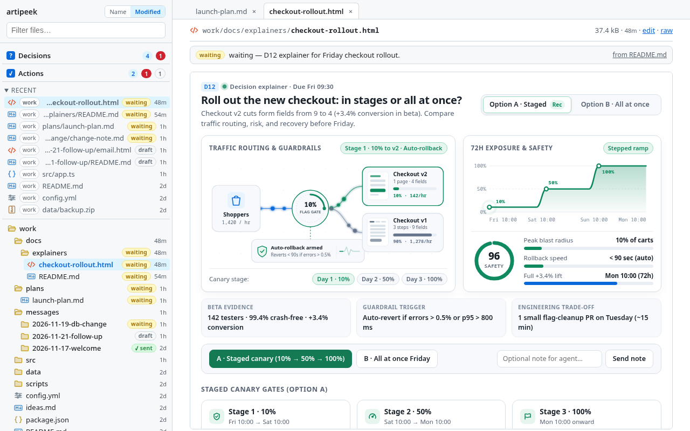
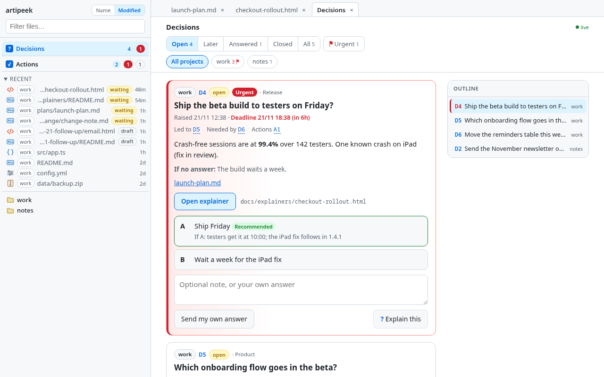
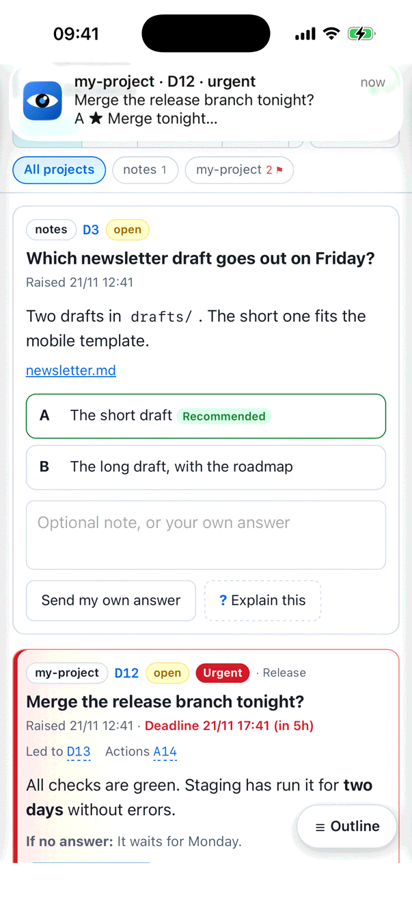
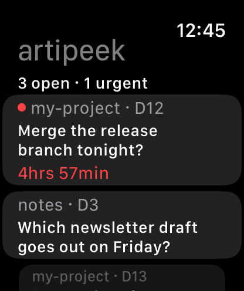

#  artipeek

AI agents write plans, reports, email drafts, and code inside your local repositories—and often pause waiting for a quick decision from you. **artipeek** gives you a live, read-only web viewer for chosen folders so you can read agent output and answer their questions from your phone or laptop. When a file changes on disk, your open page updates by itself.

Built with [Bun](https://bun.sh). It runs directly from TypeScript with no build step and no client framework. Keep it on localhost, share it with your own devices over [Tailscale](https://tailscale.com) (a private mesh VPN), or publish selected folders behind a Cloudflare Access login—with an optional iPhone and Apple Watch app for push notifications.

<p>
  
  
  
  
</p>





<sub>Screenshots use made-up demo folders.</sub>

## Quick start

Install dependencies, copy the example config, start the user service, and link the admin CLI:

```bash
git clone https://github.com/hieptuanle/artipeek ~/projects/artipeek
cd ~/projects/artipeek && bun install
mkdir -p ~/.config/artipeek && cp config.example.json ~/.config/artipeek/config.json   # then edit it
cp artipeek.service ~/.config/systemd/user/ && systemctl --user daemon-reload && systemctl --user enable --now artipeek
ln -s ~/projects/artipeek/cli.ts ~/.local/bin/artipeek   # admin CLI
```

Once running, open artipeek from whichever channel you configured:

| Access method | URL | Notes |
|---|---|---|
| Local machine | `http://127.0.0.1:4321` | Always available on localhost. |
| Your devices via [Tailscale](https://tailscale.com) | `http://<machine>.<tailnet>.ts.net:4321` | Only devices named in `allowDevices`, on a tailnet listed in `tailnets`. |
| Anywhere via public hostname (optional) | `https://artipeek.example.com` | Routed through a Cloudflare Tunnel (outbound-only, no open ports) behind Cloudflare Access (a login gate such as an email PIN). See [Public hostname](#public-hostname-cloudflare-tunnel--access). |
| iPhone and Apple Watch (optional) | Native shell app in [`ios/`](ios/README.md) | Push notifications for new and urgent decisions, with direct answers from notifications or the Watch. See [iOS app, Apple Watch and push](#ios-app-apple-watch-and-push-optional). |

Tip: on a phone, add the page to your home screen for a full-screen layout.

## Reading your files

artipeek renders files on the server and streams live updates to your browser over Server-Sent Events (SSE—a lightweight, one-way stream from the server).

### Navigation and layout

- **Home (`/`)**: shows open and urgent decision counts per folder, followed by one card per folder with its 5 newest files.
- **File page (`/r/<folder>/view/<path>`)**: shows the rendered file. On a phone, tap `☰` for the slide-in file list; on a laptop, the list stays docked on the left.
- **In-app tabs**: clicking any link to a file inside artipeek (from the file list, Markdown, HTML pages, or Decisions) opens it in an in-app tab, or switches to it if already open. **Decisions** opens as a single tab.
  - Hidden tabs stay mounted with their scroll position intact, switch instantly, and keep updating live.
  - Each browser tab keeps its own tab list in `sessionStorage` (persisting across reloads) and spans all folders.
  - Browser Back and Forward step through your tab history. Close a tab with `×` or middle-click; Ctrl/Cmd-click opens a normal browser tab. The tab bar appears once two or more tabs are open.
- **File list**: **Decisions** (open and urgent counts) sits at the top, followed by **Recent** (the 10 newest files across all folders, labeled by folder), then each folder. Folder contents load on demand; the active tab's folder and any folders you open stay expanded. Sort by **Name** or **Modified** (newest first; a folder's timestamp matches its newest file; choice saved in a cookie), or filter across every folder.
- **Single live stream**: each browser tab opens one SSE stream (`/_/events`) for all folders and decisions, keeping multiple browser tabs under browser connection limits.

### File rendering

- **Markdown (`.md`)**: GitHub-style formatting (tables, task lists, syntax-highlighted code, footnotes, heading anchors), YAML front matter rendered as a small table, relative links and images, and Obsidian `[[name]]` wikilinks.
- **HTML (`.html`)**: renders standalone pages such as email drafts and explainers inside a sandboxed frame. Inline scripts (animations, toggles) run in an opaque origin with no network access, so the page cannot read your login cookie, read other files, load remote assets, or navigate away. When the file changes and reloads, artipeek restores scroll position (and typed text in folders with answers) via `sessionStorage`. Links to other files inside artipeek open as in-app tabs through a small helper script. Opening the file directly with **raw** disables all scripts.
- **Other files**: text and source files get syntax highlighting, images display inline, and other binaries show file size and a download link.
- **File-type icons**: each file shows an icon for its type (Markdown, HTML, code by language, shell, config, images, PDF, tables, archives, diffs, SQL, media, lock files, text). Folders show an open or closed folder icon (no arrows); tap to expand or collapse.

### Status labels

artipeek extracts status badges from files and displays them in the file list, Recent, Home, and a live-updating bar beneath the file name on file pages.

- **Markdown**: reads the first `Status:` line in the first 20 lines (ignoring code blocks). Formats like `Status: sent 2026-11-01`, `STATUS: **SENT …**`, `- Status: for your yes`, and `**Status:** drafted; not sent` all match.
- **HTML (email drafts)**: reads `<meta name="x-status" content="sent">` in `<head>`, plus optional `x-sent-at` (displayed in UTC), `x-to`, and `x-subject`.
- **Folders**: inherit the status of `README.md`, `index.md`, `email.html`, or `index.html` (in that order), or the shared status if every Markdown and HTML file directly inside the folder agrees. For example, an `email.html` next to a `README.md` with `Status: sent …` shows **sent** on both the folder row and the `.html` row (tooltips show the source); non-Markdown/HTML files (`.css`, `.pdf`, etc.) do not repeat the label.

| Status text contains | Label shown |
|---|---|
| `sent`, `posted`, `replied` | **sent** |
| `not sent`, `draft`, `drafted`, `started`, `wip` | **draft** |
| `for your yes`, `for review`, `waiting`, `pending` | **waiting** |
| `done`, `ok`, `approved`, `merged` | **done** |
| Anything else | First word (`never sent` and `not approved` keep two words) |

## Decision hub

The decision hub stores questions raised by agents across all your folders in one SQLite database (via Drizzle ORM). Open it from **Decisions** at the top of the file list, at `/decisions` (every folder, with project filter and clickable project tags), or at `/r/<folder>/decisions` (one folder). The home page also shows open and urgent counts.

- **Consistent format**: agents submit structured data (title, Markdown context, options, deadline, links) instead of hand-crafted HTML. Answers use artipeek's confirmation sheet, and only you can submit them.
- **Queue and history**: **Open** and **Later** list oldest first as a queue; **Answered**, **Closed**, and **All** list newest first as history. Filter by status, **Urgent**, and project. Loads 30 decisions per page (more load at the end or via "Show more").
- **Urgency**: marked urgent when the agent sets `urgent: true` or when an open decision's deadline is less than 24 hours away (or past). Urgent cards and outline entries are highlighted.
- **Outline**: sits on the right on desktop (or behind the Outline button / floating phone button on narrow screens). Tracks the card you are reading, jumps on tap, and notes when a filter is empty ("No open decisions.").
- **Links between decisions**: supports "From D12" / "Led to" and "Depends on D13" / "Needed by", including across folders. Clicking jumps to the linked decision or overlays it if filtered out.
- **Explain this**: ask an agent for a visual explainer page instead of answering right away. It reaches the agent like an answer (`kind: "explain"`, text starting with `EXPLAIN: …`) while leaving the decision open. Once the agent links the explainer, **Open explainer** opens it in an artipeek tab next to Decisions, which keeps your place.
- **Live updates without scroll jumps**: SSE updates patch only the changed card in place. A card leaving the current filter (such as one you just answered) stays dimmed until you change filters. Typed notes, picks, focus, and scroll position survive live updates, reloads, and tab switches.
- **Legacy `decisions.html` links**: once a folder has decisions in the hub, links to its `decisions.html` (at any depth) open the hub instead (`?file=1` still shows the file).

### Connecting agents

See [docs/decisions-for-agents.md](docs/decisions-for-agents.md) for the full agent CLI and HTTP API reference.

1. Generate a per-folder token on the artipeek host: `artipeek decisions token <folder>`.
2. On the agent's machine, raise or update decisions with `artipeek-decide add --file d.json` (or the JSON API with that token). Tokens work only on `127.0.0.1` and Tailscale—never on the public listener—and cannot submit answers.

Answers save to the hub and, in folders with `answers` configured, also append a line to the answers file, commit it, and trigger `after`, so existing agent watchers keep working unchanged.

To migrate an existing `decisions.md` (`## D15 — title` + `- Key: value` format) into the hub:

```bash
bun scripts/import-decisions.ts <folder> path/to/decisions.md --dry-run
bun scripts/import-decisions.ts <folder> path/to/decisions.md
```

Open decisions import in full; answered decisions import from the last 30 days (configurable with `--days`). Raise timestamps are read from git history.

The database lives at `decisions.db` next to `config.json` (override with `"decisions": { "db": "…" }`). The schema is in `db/schema.ts`; after changing it, run `bunx drizzle-kit generate` (the server applies migrations in `drizzle/` at startup).

## Answer buttons (optional)

artipeek is read-only by default, with one per-folder exception: an HTML page in an opted-in folder can ask you for a short answer (a preset choice or typed text), and artipeek writes it back into the folder for your agents.

Enable it on a folder in `config.json`:

```json
{
  "name": "desk",
  "path": "~/projects/desk",
  "answers": {
    "file": "inbox/answers.jsonl",
    "message": "answer {id}",
    "after": ["~/.local/bin/my-sync", "desk"]
  }
}
```

### Button markup

Any element with `data-artipeek-answer="<id>"` becomes an answer button:

```html
<button data-artipeek-answer="D15" data-value="A">A</button>
<input id="d15-note"><button data-artipeek-answer="D15" data-value="B" data-input="#d15-note">B, with my note</button>
<textarea id="d16"></textarea><button data-artipeek-answer="D16" data-input="#d16">Send my answer</button>
```

- `data-value` sets a fixed choice; `data-input` points to a text field via CSS selector. When both are set, the submitted text is `<value>: <note>`.
- IDs start with a letter followed by up to 31 letters, digits, `.`, `_`, or `-`. Answer text allows up to 2,000 characters.

**Multiple questions in one decision**: add `data-question` to each choice button so tapping toggles a selection rather than sending immediately (selecting one choice clears others in the same question; tapping again deselects it). Add one send button with `data-artipeek-picks` to submit all picks for that ID in page order:

```html
<p>Q1 Who may read invoices?</p>
<button data-artipeek-answer="D201" data-question="Q1" data-value="A">A. the bot only</button>
<button data-artipeek-answer="D201" data-question="Q1" data-value="C">C. nobody</button>
<p>Q2 Add the Flexi-time position?</p>
<button data-artipeek-answer="D201" data-question="Q2" data-value="A">A. yes</button>
<button data-artipeek-answer="D201" data-question="Q2" data-value="B">B. leave it</button>
<textarea id="d201-note"></textarea>
<button data-artipeek-answer="D201" data-artipeek-picks data-input="#d201-note">Send my answers</button>
```

This sends `Q1 A, Q2 B` (or `Q1 A, Q2 —` if Q2 is unpicked), plus `: <note>` if the box has text. Active picks receive `data-artipeek-picked="true"` and `aria-pressed="true"` for styling (for example, `[data-artipeek-picked="true"]{background:var(--accent);color:#fff}`), survive live reloads, and receive `data-artipeek-chosen="true"` after saving. The page also receives an `artipeek:pick` event (`detail`: `id`, `question`, `value`, empty when turned off).

### Submission flow and permissions

1. Clicking a button asks artipeek to open **its own confirmation sheet** (outside the sandboxed page) showing the ID and exact text.
2. Only a real click on **Send** in that sheet submits the answer. The page cannot press Send, alter the previewed text, or make network requests.
3. artipeek appends one JSON line to `file`: `{"at", "uid", "id", "text", "by", "page"}`, where `by` is the Cloudflare Access email or Tailscale device name. In a git repo, it commits only that file as author `artipeek` (using `message` with `{id}` substituted) and runs `after` (if set) without blocking.
4. Matching buttons receive `data-artipeek-state="saved"`, the button matching `data-value` gets `data-artipeek-chosen="true"`, the button's input clears, and the page receives an `artipeek:answer-saved` event (`detail`: `id`, `text`, `at`, `uid`, `restored`).
5. **Reload memory**: each time artipeek serves the page, it replays the latest answer per ID from the last 48 hours (`restored: true`), keeping your sent answers marked across agent rewrites until the page itself marks them done.

**Who may answer**: authenticated users on the public listener (`public.emails`) or Tailscale devices listed in `answerDevices` (list only personal phones and tablets, because any process on a listed device can post). **Plain `127.0.0.1` is never allowed**, since local agents and scripts can reach it. Folders without `answers` (and without hub decisions) return `404` and do not load the button script.

## Configuration

artipeek reads `~/.config/artipeek/config.json`. See `config.example.json` for every supported option.

```json
{
  "port": 4321,
  "tailnet": true,
  "tailnets": ["example-tailnet.ts.net"],
  "allowDevices": ["my-phone", "my-laptop"],
  "roots": [
    { "name": "notes", "path": "~/notes" }
  ]
}
```

| Keys | When applied | Notes |
|---|---|---|
| `roots`, per-folder `answers` | Within ~1 second (no restart) | Folder names allow letters, digits, `.`, `_`, `-`. `/` and your home folder are refused as too wide. |
| `port`, `tailnet`, `tailnets`, `allowDevices`, `answerDevices`, `public`, `decisions`, `push` | At startup | Run `artipeek restart` after manual edits. The admin CLI restarts automatically when needed. |

## Admin CLI (`artipeek`)

Run `artipeek help` for the full command list.

| Command | What it does |
|---|---|
| `artipeek` | Show service status, listeners, public link, and folders (`★` = public). |
| `artipeek check` | Verify Cloudflare setup: token expiry, Access app and policy, DNS, tunnel rule, and both auth checks. |
| `artipeek add <name> <path> [--public]` | Add a folder (optionally expose it on the public hostname). |
| `artipeek remove <name>` | Remove a folder from config (files on disk are untouched). |
| `artipeek public add\|remove <name>` | Show or hide a folder on the public hostname. |
| `artipeek emails add\|remove <email>` | Manage allowed public logins (updates Cloudflare Access first, then local config). |
| `artipeek devices add\|remove <name>` | Manage allowed Tailscale device names. |
| `artipeek refused --since 24h` | Summarize refused requests grouped by reason. |
| `artipeek decisions` | Show decision counts per folder and which folders have an agent token. |
| `artipeek decisions token <name>` | Generate a new agent token for a folder (printed once). |
| `artipeek logs -f \| restart \| test \| undo-config` | Follow logs, restart service, run tests, or restore previous config. |

- Edits to `config.json` are atomic and back up the prior version to `config.json.prev` (`artipeek undo-config` restores it, without reverting Cloudflare changes).
- The CLI automatically restarts the service when changing startup-only settings.
- `emails` updates Cloudflare first; if that fails, `config.json` stays untouched. Removing the last allowed email is refused.
- Cloudflare commands read an API token from `~/.config/artipeek/cf-token` (mode `600`, never printed) and IDs from `public.cloudflare`.

## Safety

artipeek assumes agent-written files may be untrusted and enforces strict boundaries on what is exposed, who can connect, and what can write.

- **Allowed files**: in git repos, only files git lists (tracked files plus untracked files not ignored by `.gitignore`). Outside git repos, all files except `.git` and `node_modules`. `.git/` is never served.
- **Hard deny list (never shown, even if tracked)**: `.env` and `.env.*` (except `.env.example`, `.env.sample`, `.env.template`), `.netrc`, `.pgpass`, `.npmrc`, `id_rsa`/`id_dsa`/`id_ecdsa`/`id_ed25519` keys (and `.pub`), `*.pem`, `*.key`, `*.p12`, `*.pfx`, `*.kdbx`, `*.ppk`, `*.keystore`, `*.jks`.
- **Path containment**: every requested path—including symlinks—must resolve inside its folder. `..`, absolute paths, backslashes, and symlinks pointing outside return `404`.
- **Read-only with narrow write exceptions**: only `GET` and `HEAD` are accepted; all other methods return `405`, except:
  - `POST /r/<folder>/answer` (folders with `answers` configured or decisions in the hub): requires a Cloudflare Access login or a device in `answerDevices` (never plain `127.0.0.1`), `Sec-Fetch-Site: same-origin` (set by the browser, not by page scripts), `X-Artipeek: answer`, and a JSON body under 8 KB (forcing any cross-site attempt into a CORS preflight, which gets `405`). Appends one line to one file inside the folder (no outbound symlinks), commits only that file, and never logs answer text. Native iOS and Watch answers send the same headers with the Access login cookie.
  - Decision hub agent API (`/api/…`): requires the folder's hashed bearer token on every call (even from `127.0.0.1`), is disabled on the public listener, and cannot submit answers. Agent text is Markdown with raw HTML disabled.
  - Push registration (`POST /_/push/…`): enforces the same caller, origin, and JSON checks as answers, with `X-Artipeek: push`.
- **Network listeners**: listens only on `127.0.0.1` and, when `tailnet` is `true`, the machine's Tailscale IP (checked every 15 s to follow tailnet changes). Never listens on Wi-Fi/LAN. Public access goes only through a Cloudflare Tunnel to the separate `public` listener, which requires Cloudflare Access.
- **Tailscale device check**: every tailnet request is verified via `tailscale whois` and served only if the peer matches `<host>.<tailnet>` with `host` in `allowDevices` and `tailnet` in `tailnets`. All other tailnet requests return `403` and log one line (IP, device name, path—never file contents). `127.0.0.1` is always served.
- **Browser isolation**: strict Content-Security-Policy allows only the server's own small script and blocks remote images, fonts, and scripts. Raw files receive `CSP: sandbox` (opaque origin, no network). `.html` files get `allow-scripts` for inline scripts only when framed inside artipeek's file page (`Sec-Fetch-Dest: iframe`, `Sec-Fetch-Site: same-origin`), where `frame-src 'self'` prevents navigating away; `allow-same-origin` is never set.
- **No content logging or telemetry**: file contents and answer text are never logged. Outbound requests occur only to fetch Cloudflare Access public signing keys (when `public` is configured) and to send APNs push notifications containing only folder, decision ID, and title (when `push` is configured).

## Public hostname (Cloudflare Tunnel + Access)

Expose selected folders over HTTPS from anywhere without opening inbound firewall ports:

`Browser → https://artipeek.example.com → Cloudflare Access (login, e.g. email PIN) → Cloudflare Tunnel (cloudflared) → 127.0.0.1:4323`

> Never point the tunnel at the main port (`4321`): the main listener trusts all requests from `127.0.0.1`, and `cloudflared` connects from `127.0.0.1`. Always point it at the separate `public.port`.

```json
"public": {
  "port": 4323,
  "hostname": "artipeek.example.com",
  "teamDomain": "<team>.cloudflareaccess.com",
  "aud": "<Access application AUD tag>",
  "emails": ["you@example.com"],
  "roots": ["notes"]
}
```

- **Double-checked login**: every request on the public listener must carry a valid Cloudflare Access JWT (JSON Web Token, via header `Cf-Access-Jwt-Assertion` or cookie `CF_Authorization`). artipeek verifies the RS256 signature against `https://<team>.cloudflareaccess.com/cdn-cgi/access/certs` (keys cached 1 hour, refetched on unknown key ID), plus `aud`, `iss`, `exp`/`nbf`, and `emails`. Invalid requests get `403` and log the reason (never the token)—so artipeek refuses unauthorized traffic even if the Access app is deleted or misconfigured.
- **Scoped folders**: only folders in `public.roots` exist on the public listener; all others return `404` and are hidden. Keep confidential folders out of `public.roots`.
- **Live updates**: uses the same SSE stream with a keepalive ping every 25 s so Cloudflare does not drop idle connections.
- `certsUrl` exists only for automated tests (fake certs endpoint); do not set it in a real config.

### Setup steps

1. Add a tunnel ingress rule `artipeek.example.com → http://127.0.0.1:4323` (above the catch-all `http_status:404`) and a proxied CNAME `artipeek → <tunnel id>.cfargotunnel.com`.
2. Create a self-hosted Cloudflare Access application for the hostname with an Allow policy for your email(s) (session duration up to 730 h / 1 month).
3. Put the app's AUD tag and your team domain in `public`, then run `artipeek restart` and `artipeek check`.

To undo: delete the Access app, DNS record, and tunnel rule; revoke the API token; remove `public` from `config.json`; and run `artipeek restart`.

## iOS app, Apple Watch and push (optional)

[`ios/`](ios/README.md) contains a SwiftUI shell around artipeek's web UI (`WKWebView`), so web updates appear in the app immediately without rebuilding. Native features add push notifications, app icon badges, Cloudflare Access login, notification answer buttons, settings (server URL, notifications toggle, test push, sign out), and an Apple Watch companion app with a watch-face complication. See [`ios/README.md`](ios/README.md) for Xcode and TestFlight build steps.

<p>
  
  
  
</p>


<p>
  
  
  
</p>

<sub>Screenshots use made-up demo folders.</sub>

### Push notifications (APNs)

The server pushes through APNs (Apple Push Notification service, using token auth with a `.p8` key from your Apple Developer team) when a decision is:

- **new**: raised while open (title `<folder> · <id> · new`, body = decision title).
- **urgent**: open with `urgent: true` or a deadline within 24 hours / past (title `<folder> · <id> · urgent`). A decision raised already urgent sends one urgent push.

```json
"push": {
  "apns": {
    "keyPath": "~/keys/AuthKey_XXXXXXXXXX.p8",
    "keyId": "XXXXXXXXXX",
    "teamId": "XXXXXXXXXX",
    "bundleId": "com.example.artipeek"
  }
}
```

- **Deduplication and history**: each decision sends at most one push per kind (tracked in the hub's `push_sent` table across restarts and re-imports). Decisions first seen more than 15 minutes after their last change (such as imports or pre-existing items) are marked seen without pushing. The server checks after every change, on external database writes, and once per minute for deadlines.
- **Payload**: badge = open decisions visible to that device; `thread-id` = folder; custom data `{project, id, url}` opens the decision on tap.
- **Key and config**: read at startup (`artipeek restart` after edits). Keep the `.p8` file private (`chmod 600`); it is never copied or logged. One APNs key works for every app on the team. `origin` (inside `apns`) exists only for tests (fake APNs); do not set it in production.
- **Device registration**: the app calls `POST /_/push/register` (`/unregister`, `/test`) from its web view, carrying the page login and obeying the answer rules (Access login or `answerDevices`, never plain `127.0.0.1` or agent tokens, `Sec-Fetch-Site: same-origin`, `X-Artipeek: push`, JSON body). Devices registered via the public listener receive notifications and badge counts only for `public.roots`.
- **Notification answer buttons**: a single-question decision with up to 4 options displays them in the notification and as action buttons—letters for standard sets (`A/B`, `A/B/C`, `A/B/C/D`, `Y/N`, also shown on Apple Watch) or option labels via the notification extension. Other decisions offer **Reply…** (type, dictate, or scribble) and **Open**. Tapping saves immediately via `POST /r/<folder>/answer` (source `artipeek:push`) and displays `"Saved: D4 → A"`. Action buttons require an unlocked phone or Watch.
- **Apple Watch app**: lists open decisions (urgent first), confirms each answer before saving (source `artipeek:watch`), and provides a complication with open and urgent counts. It reads the read-only endpoint `GET /decisions/part/app.json` using the login passed from the iPhone app.
- **Environments and cleanup**: each device token stores its APNs environment (`sandbox` for development builds, `production` for TestFlight). Tokens APNs reports gone (`410`, `BadDeviceToken`) are removed automatically and re-registered on next launch.

## Service and development

The systemd user unit lives at `~/.config/systemd/user/artipeek.service` (source copy: `artipeek.service`). It starts at login and restarts on failure.

```bash
artipeek                                   # or: systemctl --user status artipeek
artipeek restart                           # after editing server.ts
artipeek logs -f                           # inspect refused requests and loaded folders
```

For local development with auto-reload on save:

```bash
bun run dev
```

This runs on port `4322` using your existing config (and also listens on the Tailscale IP at `4322` when `tailnet: true`).

## Tests

All tests use temporary folders and a temporary config—never your real repositories. Run `bun install` once first.

| Command | What it tests |
|---|---|
| `bash test.sh` (or `artipeek test`) | Home page, sidebar, folder switcher, phone menu, Markdown, sandboxed HTML, status labels, file-type icons, path escapes and deny list (`404`), `POST` (`405`), live config reload, bad root names / home folder rejection, sort cookie, live SSE events within 2 s, no file contents in logs, answer endpoint checks, public listener JWT checks (`test-access.ts`, including ~30 s wait for key refetch limit), admin CLI on temp config, and Tailscale device checks when Tailscale is running. |
| `bun run test:answers` | Browser tests (Chromium): confirm sheet isolation, Cancel vs Send, JSON line + git commit, `artipeek:answer-saved` callback, choice + note, free text, empty answer handling. |
| `bun run test:decisions` | Browser tests (Chromium): agent token API auth and restrictions, single-stream folder scoping, queue/history order, pagination (30/page), urgency, outline, cross-decision links, filters, jump-free live updates (desktop and phone), notes/picks survival, multi-question answers, explainer flow, all-folders view, external DB writes, `decisions.html` redirect. |
| `bun run test:tabs` | Browser tests (Chromium): tab opening/switching, sidebar highlight tracking, cached tab scroll position, preserved HTML iframes, links inside HTML, Back navigation, live updates on hidden tabs, closing, reload persistence, lazy folder loading, multi-folder tabs, single Decisions tab, per-browser-tab lists, phone viewport. |
| `bun run test:push` | Fake local HTTP/2 APNs server checking ES256 auth: registration rules, single push per new/urgent decision, silent history/imports, restart persistence, `public.roots` scoping, dead token removal, payload fields (`title`, `body`, `badge`, `thread-id`, `data`), and test push. |

Browser tests require Chromium (set `CHROME_PATH` if it is not at `/usr/bin/chromium`).

## Uninstall

Undo the [public hostname](#public-hostname-cloudflare-tunnel--access) setup first if configured, then remove the service, CLI symlink, repo, and config:

```bash
systemctl --user disable --now artipeek
rm ~/.config/systemd/user/artipeek.service && systemctl --user daemon-reload
rm -f ~/.local/bin/artipeek
rm -rf ~/projects/artipeek ~/.config/artipeek
```

## Contributing: secrets scan before each commit

`bun install` installs a git pre-commit hook (`scripts/install-hooks.sh`, run via `postinstall`). On every commit it runs `scripts/pre-commit`, which scans staged changes with the [Infisical CLI](https://infisical.com/docs/cli/overview) (`infisical scan git-changes --staged --redact`).

- Any detected secret blocks the commit and is displayed redacted. If the scanner is missing or fails, the commit is blocked as well.
- Existing pre-commit hooks not installed by artipeek are left untouched (the installer prints the line to add instead).
- Skip once: `git commit --no-verify`. Disable: `git config hooks.infisical-scan false`.

## License

MIT, see [LICENSE](LICENSE).
