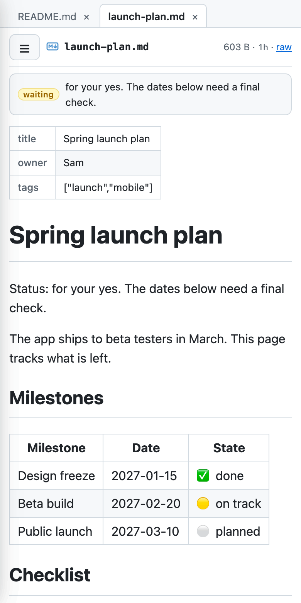

#  artipeek

Read files from chosen folders (repos) in a browser, mainly on the phone, while agents write them. It is read-only and live: when a file changes, the open page updates by itself.

Built with [Bun](https://bun.sh). One server file, no build step, no client framework.

<p>
  
  
  
  
</p>


<sub>Screenshots use made-up demo folders.</sub>

## Open it

- On the machine: **http://127.0.0.1:4321**
- From your other devices over [Tailscale](https://tailscale.com): **http://&lt;machine&gt;.&lt;tailnet&gt;.ts.net:4321** (only devices you list).
- Optional, from anywhere: **https://artipeek.example.com** through a Cloudflare Tunnel, behind a Cloudflare Access login (see "Public hostname").

Tip: on the phone, add the page to the home screen.

## What you see

- **Home (`/`)**: one card per folder with its 5 newest files.
- **File page (`/r/<folder>/view/<path>`)**: the file, rendered on the server. On a phone, tap ☰ for the file list (it slides in). On a laptop, the list sits on the left.
- **Tabs**: a click on a link to a file here (in the file list, in a Markdown file, in an HTML page, on the Decisions tab) opens it in a new tab inside the page and switches to it. If that file is already open, it switches to that tab. The file list highlights the file of the active tab. **Decisions** (see "Decision hub") is a tab too, at most one.
  - Old tabs stay in the page, with their scroll position, so switching back is instant. They still update live while hidden.
  - The tab list belongs to one browser tab (`sessionStorage`): a second browser tab has its own list, and a reload keeps it.
  - One list holds files from all folders. Back and Forward walk through the tabs you viewed.
  - Close a tab with × or a middle click. Ctrl/Cmd-click still opens a real browser tab. The tab bar shows from two tabs up.
- File list: **Decisions** (open and urgent counts) at the top, then "Recent" (the 10 newest files of every folder, with the folder's name), then every folder. A folder opens to its files and folders (loaded when you open it; the folder of the active tab is open, and the ones you opened stay open). Sort by **Name** or **Modified** (newest first; a folder counts as new as its newest file), filter box (searches every folder). The sort choice is kept in a cookie.
- One live stream per browser tab (`/_/events`) for every folder and the decisions, so several browser tabs stay under the browser's limit of connections.
- `.md`: GitHub-style (tables, task lists, code highlight, footnotes, heading anchors), front matter as a small table, relative links and images, Obsidian `[[name]]` links.
- `.html` (e.g. email drafts, explainers): shown as the page itself, in a sandboxed box. When the file changes and the
  page reloads, it keeps its scroll position (and, in folders with answers, what you typed in its text boxes): the
  page tells artipeek, which keeps it in this browser tab's `sessionStorage` and hands it to the new page. Inside the file page, the page's own inline scripts run (animations, toggles), in a separate origin with no network: it can't read your login cookie or other files, load anything, or leave for another site. Links in it to files here open as tabs: artipeek adds one small script for that, and the page can only ask to open a file. Opened on its own with "raw", it runs no scripts.
- Other text: highlighted code. Images: shown. Other binary files: size + download.
- **Icons**: every file has a small icon for its type (Markdown, HTML, code by language, shell, config, images, PDF, tables, archives, diffs, SQL, media, lock files, text). Folders show an open or a closed folder (no arrows); tap to open or close.
- **Status labels**: a Markdown file with a `Status:` line near the top (first 20 lines, not in a code block) gets a label: **sent**, **waiting**, **draft**, **done**, or the first word for anything else. These all work: `Status: sent 2026-11-01`, `STATUS: **SENT …**`, `- Status: for your yes`, `**Status:** drafted; not sent`.
  - An HTML file (an email draft) can carry its own status in its `<head>`: `<meta name="x-status" content="sent">`, plus optional `x-sent-at` (shown in UTC), `x-to` and `x-subject`. The file page shows them in the status bar.
  - A folder takes the status of its `README.md`, `index.md`, `email.html` or `index.html` (in that order), or, if every Markdown and HTML file directly in it has the same status, that one. So an email draft (`email.html`) next to a `README.md` that says `Status: sent …` shows **sent**: on the folder row and on the `.html` file's row (the tooltip says where it comes from). Other files in that folder (`.css`, `.pdf`, …) get no label, so the list doesn't repeat it.
  - Labels show in the file list, in Recent and on the home page. On the file page, a bar under the file name shows the full status line and where it comes from. It updates live when the file changes.
  - Rules: `sent`/`posted`/`replied` → **sent**; `not sent`, `draft`, `drafted`, `started`, `wip` → **draft**; `for your yes`, `for review`, `waiting`, `pending` → **waiting**; `done`, `ok`, `approved`, `merged` → **done**; anything else shows its first word (`never sent` and `not approved` keep two).

## Install

```bash
git clone https://github.com/hieptuanle/artipeek ~/projects/artipeek
cd ~/projects/artipeek && bun install
mkdir -p ~/.config/artipeek && cp config.example.json ~/.config/artipeek/config.json   # then edit it
cp artipeek.service ~/.config/systemd/user/ && systemctl --user daemon-reload && systemctl --user enable --now artipeek
ln -s ~/projects/artipeek/cli.ts ~/.local/bin/artipeek   # admin CLI
```

## Config: `~/.config/artipeek/config.json`

```json
{
  "port": 4321,
  "tailnet": true,
  "tailnets": ["example-tailnet.ts.net"],
  "allowDevices": ["my-phone", "my-laptop"],
  "roots": [
    { "name": "notes", "path": "~/notes" }
  ]
}
```

- **roots**: add or remove a folder and save. The server picks it up within a second, with no restart. Names: letters, digits, `.`, `_`, `-`. Your home folder and `/` are refused (too wide).
- **answers** (per folder, optional): see "Answer buttons". Picked up like **roots**, with no restart.
- **port, tailnet, tailnets, allowDevices, answerDevices, public**: read at start. After changing them, restart the service (`artipeek restart`). The CLI does this for you.
- `config.example.json` has every option.

## Answer buttons (optional)

artipeek is read-only, with one exception you switch on per folder: an HTML page in that folder can ask the person
reading it for a short answer (pick a choice, or type one), and artipeek saves it into the folder. Made for agents
that keep a page of questions for you: you answer on the phone, an agent reads the file and carries on.

```json
{ "name": "desk", "path": "~/projects/desk",
  "answers": { "file": "inbox/answers.jsonl", "message": "answer {id}", "after": ["~/.local/bin/my-sync", "desk"] } }
```

In the page, any element with `data-artipeek-answer="<id>"` is an answer button:

```html
<button data-artipeek-answer="D15" data-value="A">A</button>
<input id="d15-note"><button data-artipeek-answer="D15" data-value="B" data-input="#d15-note">B, with my note</button>
<textarea id="d16"></textarea><button data-artipeek-answer="D16" data-input="#d16">Send my answer</button>
```

`data-value` is a fixed choice, `data-input` a CSS selector of a text box in the page; with both, the text is
`<value>: <note>`. Ids: a letter, then up to 31 letters, digits, `.`, `_`, `-`. Text: up to 2,000 characters.

**Several questions in one decision**: give each choice a `data-question`. Such a button is a pick, not a send: a
tap turns it on (and the other choices of that question off), a second tap turns it off. One button with
`data-artipeek-picks` sends all the picks of that id at once, in page order:

```html
<p>Q1 Who may read invoices?</p>
<button data-artipeek-answer="D201" data-question="Q1" data-value="A">A. the bot only</button>
<button data-artipeek-answer="D201" data-question="Q1" data-value="C">C. nobody</button>
<p>Q2 Add the Flexi-time position?</p>
<button data-artipeek-answer="D201" data-question="Q2" data-value="A">A. yes</button>
<button data-artipeek-answer="D201" data-question="Q2" data-value="B">B. leave it</button>
<textarea id="d201-note"></textarea>
<button data-artipeek-answer="D201" data-artipeek-picks data-input="#d201-note">Send my answers</button>
```

This sends `Q1 A, Q2 B`, or `Q1 A, Q2 —` when Q2 has no pick, plus `: <note>` when the box has text (artipeek's
sheet shows it before Send). A pick that is on has `data-artipeek-picked="true"` and `aria-pressed="true"`, so
style it in the page, for example `[data-artipeek-picked="true"]{background:var(--accent);color:#fff}`. Picks
not yet sent survive a live reload; after a save, the sent picks get `data-artipeek-chosen="true"`. The page
also gets an `artipeek:pick` event (`detail`: `id`, `question`, `value`, empty when turned off).

1. A click asks artipeek; artipeek shows **its own sheet** (outside the page) with the id and the exact text.
2. Only a real click on **Send** in that sheet posts it. The page can open the sheet, but it can't press Send,
   change what the sheet shows, or send anything itself (it still has no network).
3. artipeek appends one JSON line to `file`: `{"at", "uid", "id", "text", "by", "page"}`, where `by` is the
   Access login email or the tailnet device name. If the folder is a git repo it commits only that file, as author
   `artipeek` (message from `message`, `{id}` = the id), then runs `after` (if set) without waiting for it.
4. The page hears back: matching buttons get `data-artipeek-state="saved"`, the button whose `data-value` matches
   gets `data-artipeek-chosen="true"`, and the page gets an `artipeek:answer-saved` event (`detail`: `id`, `text`,
   `at`, `uid`, `restored`), so it can mark the question as sent. The clicked button's text box is emptied.
5. **Live reloads don't forget**: every time artipeek serves the page it sends along the latest answer per id from
   the last 48 hours, and the page hears them again (`restored: true`). So when an agent rewrites the page, the
   answers you sent stay marked until the page itself shows them as done.

**Who may answer**: the public listener (an Access login from `public.emails`), or a tailnet device listed in
`answerDevices` (put only phones and tablets there: any process on a listed device could post). **Never plain
127.0.0.1**, because every local process can reach it, agents included. Folders without `answers` get 404, and
their pages don't get the button script.

## Decision hub

One place for every folder's decisions that agents want from you, in one database (SQLite, via Drizzle ORM). It is
a tab of the app: **Decisions** at the top of the file list, or **`/decisions`** (every folder, with a project
filter and a project tag on each card; a tag also filters) and **`/r/<folder>/decisions`** (the same tab, filtered to
one folder). Links on it (files, explainers) open as artipeek tabs next to it. The home page shows how many are
open and urgent.

- **Old links**: once a folder has decisions in the hub, a link to its `decisions.html` (at any depth) opens the hub
  page instead (`?file=1` still shows the file).
- **Same shape everywhere**: agents send data (title, Markdown context, choices, deadline, links), not HTML.
  Answer buttons work the same as on any page here: artipeek's own sheet confirms, only you can send.
- **Order**: Open and Later read as a queue, oldest first; Answered, Closed and All as history, newest first.
  Filters at the top: Open / Later / Answered / Closed / All, **Urgent**, and the project.
- **A page at a time**: 30 decisions; the next 30 load when you reach the end (or tap "Show more").
- **Urgent**: the agent's flag, or a deadline less than 24 h away (or past), while open. Urgent cards and their
  outline rows are highlighted.
- **Outline** on the right (narrower screens: the Outline button; a phone: the floating one): one row per decision;
  a tap scrolls there. The row of the card you're reading is highlighted. With nothing in the filter it says so
  ("No open decisions.").
- **Links between decisions**: "From D12" (came out of it), "Depends on D13" (waits for it), and back the other
  way ("Led to", "Needed by"), also across folders. A tap scrolls there, or shows it on top if it isn't in the list.
- **Explain this**: instead of answering, ask the desk for a page that illustrates the decision and its options.
  It reaches the agent like an answer (`kind: "explain"`, text `EXPLAIN: …`). The decision stays open. When the
  agent links the page, **Open explainer** opens it as a tab; the Decisions tab keeps its place.
- **No reloads, no jumps**: changes come over a live stream and patch only the card that changed. What you are
  reading stays exactly where it is: new decisions, longer updates above, a changed title. A card that leaves the
  filter (you just answered it) stays, dimmed, until you change the filter. Typed notes, picks and focus survive.
  So does a reload, and switching tabs: you come back to the same card.

**For agents**: [docs/decisions-for-agents.md](docs/decisions-for-agents.md). In short:
`artipeek decisions token <folder>` here, then `artipeek-decide add --file d.json` (or the JSON API with that
token) on the agent's machine. Tokens work on 127.0.0.1 and the tailnet, never on the public listener, and they
can't answer.

Answers are saved in the hub and, in folders with `answers` set, also as before: a line in the answers file, a
commit, the `after` command. So the agents' watchers don't change.

Moving a desk's existing `decisions.md` (the `## D15 — title` + `- Key: value` format) into the hub:
`bun scripts/import-decisions.ts <folder> path/to/decisions.md --dry-run`, then without `--dry-run`. Open ones come
in fully, answered ones from the last 30 days (`--days`). Raise times come from git.

The database is `decisions.db` next to the config (or `"decisions": { "db": "…" }`). Schema: `db/schema.ts`;
after changing it, `bunx drizzle-kit generate` (the server applies `drizzle/` at start).

## Admin CLI: `artipeek`

Run `artipeek help` for the full list.

```bash
artipeek                          # status: service, listeners, public link, folders (★ = public)
artipeek check                    # Cloudflare: token expiry, Access app + policy, DNS, tunnel rule, both locks
artipeek add notes ~/notes        # add a folder (add --public to also show it on the public link)
artipeek remove notes             # remove a folder (files are not touched)
artipeek public add|remove NAME   # show / hide a folder on the public hostname
artipeek emails add|remove EMAIL  # who may log in: updates the Access policy, then artipeek's own list
artipeek devices add|remove NAME  # tailnet devices
artipeek refused --since 24h      # refused requests, grouped by reason
artipeek decisions                # decision hub: counts per folder, which have an agent token
artipeek decisions token NAME     # new agent token for a folder (printed once)
artipeek logs -f | restart | test | undo-config
```

- It edits the config with an atomic write and keeps the previous copy in `config.json.prev` (`artipeek undo-config` puts it back; it does not undo Cloudflare changes).
- It restarts the service by itself when a setting is read only at start.
- `emails` changes Cloudflare first. If that fails, the config stays as it was. It refuses to remove the last email.
- Cloudflare commands use an API token in `~/.config/artipeek/cf-token` (mode 600, never printed) and the IDs in `public.cloudflare`.

## Safety

- **Which files**: only what git would list in each folder (tracked + new files not ignored by `.gitignore`). A folder without git: all files except `.git` and `node_modules`. `.git/` is never served.
- **Never shown, even if tracked**: `.env` and `.env.*` (but `.env.example` / `.sample` / `.template` are shown), `.netrc`, `.pgpass`, `.npmrc`, `id_rsa` / `id_ed25519` style keys, `*.pem`, `*.key`, `*.p12`, `*.pfx`, `*.kdbx`, `*.ppk`, `*.keystore`, `*.jks`.
- **Paths**: every path must resolve inside its folder (symlinks too). `..`, absolute paths, backslashes and symlinks pointing outside give 404.
- **Read-only**: GET/HEAD only, others get 405. One exception, only in folders with `answers` set:
  `POST /r/<folder>/answer` (see "Answer buttons"). It needs an Access login or a device in `answerDevices` (never
  plain 127.0.0.1), `Sec-Fetch-Site: same-origin` (set by the browser, not by pages), an `X-Artipeek: answer` header and a
  JSON body under 8 KB (so a cross-site request needs a CORS preflight, which gets 405). It appends one line to one
  file inside the folder (no symlinks out) and commits only that file. The answer text is never logged.
  The decision hub's agent API (`/api/…`) also writes: it needs the folder's token (stored hashed) on every call, even
  from 127.0.0.1, is not on the public listener, and can't answer. Agent text is Markdown without raw HTML.
  `POST /_/push/…` (the iOS app's device registration) follows the answer rules (see "iOS app and push").
- **Network**: listens on 127.0.0.1, plus the machine's Tailscale IP if `tailnet` is true. It does not listen on Wi-Fi/LAN. A public hostname reaches it only through a tunnel to the separate `public` listener, which requires a Cloudflare Access login. It checks the Tailscale IP every 15 s and moves when the machine switches tailnet.
- **Device check**: every tailnet request is checked with `tailscale whois`. It is served only if the device name is `<host>.<tailnet>` with host in `allowDevices` and tailnet in `tailnets`. Everything else gets 403 and one log line: IP, device name, path, never contents. 127.0.0.1 is always served.
- **Browser**: strict Content-Security-Policy (only the server's own small script runs; no remote images, fonts or scripts). Raw files get `CSP: sandbox` (opaque origin, no network). `.html` gets `allow-scripts` with inline scripts only when the browser loads it in artipeek's own file page (`Sec-Fetch-Dest: iframe`, `Sec-Fetch-Site: same-origin`); that page's `frame-src 'self'` keeps the frame from navigating away. Never `allow-same-origin`.
- It never logs file contents and sends nothing anywhere (it only fetches the Cloudflare Access public keys when `public` is set, and with `push` set, sends notifications to Apple's push service: folder, id and title of a decision).

## Public hostname (Cloudflare Tunnel + Access)

How a request flows: browser → `https://artipeek.example.com` → Cloudflare Access (login, e.g. one-time PIN by email) → a Cloudflare Tunnel (`cloudflared`) on the machine → **`127.0.0.1:4323`**, a separate listener. Never point the tunnel at the main port: it trusts every request from 127.0.0.1, and cloudflared connects from 127.0.0.1.

```json
"public": {
  "port": 4323,
  "hostname": "artipeek.example.com",
  "teamDomain": "<team>.cloudflareaccess.com",
  "aud": "<Access application AUD tag>",
  "emails": ["you@example.com"],
  "roots": ["notes"]
}
```

- **Every request** on the public listener needs a valid Access JWT (header `Cf-Access-Jwt-Assertion` or cookie `CF_Authorization`): RS256 signature checked against `https://<team>.cloudflareaccess.com/cdn-cgi/access/certs` (keys cached 1 h, refetched on an unknown key id), plus `aud`, `iss`, `exp`/`nbf`, and the email in `emails`. Anything else gets 403 and one log line with the reason (never the token). So even if the Access app is deleted or misconfigured, artipeek still refuses.
- Only folders in `public.roots` exist there. Others give 404 and are not listed. Keep anything confidential out of it.
- Everything else is the same as on the main port. Live updates use the same SSE stream, with a ping every 25 s so Cloudflare does not drop it.
- `certsUrl` exists only for the tests (fake certs endpoint). Do not set it in a real config.

Setup outline (Cloudflare dashboard or API):

1. A tunnel rule `artipeek.example.com → http://127.0.0.1:4323` (before the catch-all `http_status:404`), and a proxied CNAME `artipeek → <tunnel id>.cfargotunnel.com`.
2. An Access application (self-hosted) for the hostname, with an Allow policy for your email(s). Session duration: up to 730 h (1 month).
3. Put the app's AUD tag and your team domain in `public`, then `artipeek restart` and `artipeek check`.

Undo: delete the Access app, the DNS record and the tunnel rule; revoke the API token; remove `public` from the config and restart.

## iOS app and push (optional)

`ios/` holds a small iOS app: a native SwiftUI shell around artipeek's own web UI (a `WKWebView`), so every web
feature is in the app without an app update. Native parts: push notifications, the badge, the login (the Cloudflare
Access page inside the app's web view), and settings (server URL, notifications on/off, a test push, sign out).
Build and TestFlight steps: [`ios/README.md`](ios/README.md).

The server pushes through APNs (token auth, a `.p8` key from your Apple developer team) when a decision is:

- **new**: raised and open. Title `<folder> · <id> · new`, body the decision's title.
- **urgent**: open and the agent sets `urgent: true`, or its deadline comes within 24 h (or passes). Title
  `<folder> · <id> · urgent`. A decision raised already urgent gets one push, the urgent one.

Each decision gets at most one push of each kind (recorded in the hub's `push_sent` table, so a restart or a re-import
never pushes again). History never pushes: a decision first seen after it was raised and last changed more than 15
minutes ago (an import, a decision from before push was set up) is marked seen without a push. The server checks after
every change, when another process writes the database, and once a minute for deadlines. The badge is the number of
open decisions the device can see; `thread-id` is the folder; custom data `{project, id, url}` opens the decision.

```json
"push": {
  "apns": { "keyPath": "~/keys/AuthKey_XXXXXXXXXX.p8", "keyId": "XXXXXXXXXX", "teamId": "XXXXXXXXXX", "bundleId": "com.example.artipeek" }
}
```

- Read at start (`artipeek restart` after a change). Keep the key file private (`chmod 600`); it is never copied or
  logged. One APNs key works for every app of the team.
- Devices register with `POST /_/push/register` (`/unregister`, `/test`), which follow the answer rules: an Access login
  or a device in `answerDevices` (never plain 127.0.0.1, never an agent token), `Sec-Fetch-Site: same-origin`, an
  `X-Artipeek: push` header and a JSON body. The app sends them from its web view, so they carry the page's login.
- A device registered through the public listener only hears about `public.roots`, and its badge counts only those.
- Each token keeps its APNs environment (a development build: sandbox; TestFlight: production). A token APNs calls
  gone (410, `BadDeviceToken`) is dropped; the app registers again when it next opens.
- `origin` (in `apns`) exists only for the tests (a fake APNs). Do not set it in a real config.

## Service

```bash
artipeek                                   # or: systemctl --user status artipeek
artipeek restart                           # after editing server.ts
artipeek logs -f                           # who was refused, which folders loaded
```

The unit file is `~/.config/systemd/user/artipeek.service` (copy: `artipeek.service`). It starts at login and restarts on failure.

Develop: `bun run dev` (port 4322, reloads on save). This uses the same config; with `tailnet: true` it also listens on the tailnet IP at 4322.

## Tests

```bash
bun install   # once
bash test.sh  # or: artipeek test
```

The tests use temporary folders and a temporary config, never your repos. They cover: the home page; the sidebar, folder switcher and phone menu; Markdown (tables, code, tasks, footnotes, front matter, wikilinks, relative and `/` links); HTML in a sandbox (inline scripts only inside the file page; opened directly or framed by another site: no scripts; other raw files: no scripts); status labels (file, folder, README, code blocks ignored, live update); file-type icons; path escapes, other folders, `.git`, ignored and denied files → 404; POST → 405; adding a folder by editing the config; refusing a bad name or the home folder; sort and cookie; live events per folder within 2 s; no file contents in the log.

Answer buttons are tested in a real browser with `bun run test:answers` (same Chromium setup): a page's own message
only opens the sheet, Cancel saves nothing, Send saves one line and commits it, the page hears back, choice + note
and free text, empty answers. `test.sh` covers the endpoint: login, device and same-origin checks, bad input,
size limits, folders without answers, nothing logged.

The decision hub is tested in a real browser with `bun run test:decisions`: the token API (other folder's token,
no token, public listener, bad links all refused; an agent on 127.0.0.1 can't answer), the app's one stream keeping
to the listener's folders, order (newest first for history), a page of 30 and the rest at the end, urgency, outline
(and its empty text),
links between decisions, filters, live updates that keep what you read in place (laptop and phone), typed notes and
picks through a live change, answers and multi-question picks through the sheet (line + commit + hub), explainer
requests and the explainer viewer, the all-folders page, an outside write showing up live, the old link redirect.

App tabs are tested in a real browser with `bun run test:tabs` (needs Chromium; set `CHROME_PATH` if it isn't at `/usr/bin/chromium`): links open and switch tabs, the file list highlight follows, switching back makes no request and keeps the scroll, HTML frames aren't reloaded, links inside HTML pages, Back, live update of a hidden tab, closing, reload, every folder in the file list (loaded when opened), a file of a second folder, the one Decisions tab, a separate list per browser tab, phone width.

Push is tested with `bun run test:push` against a fake APNs (a local http2 server that checks the ES256 token): who
may register (127.0.0.1, an agent token, no login, a cross-site request → refused; an Access login → ok), new and urgent
each push once, history and an outside import push nothing, nothing again after a restart, folders that aren't public
stay quiet for a public device, dead tokens are dropped, the payload (title, body, badge, thread-id, data), the test push.

The public listener is tested with a local fake certs endpoint and locally made RSA keys (`test-access.ts`): no token, bad signature, wrong aud/iss, expired, wrong email, `alg: none` → 403; valid header or cookie → 200; folders not in `public.roots` → 404 and not listed; path escapes → 404; key rotation; SSE with a token. This part waits ~30 s on purpose (key refetch limit). The admin CLI is tested on a temp config. If Tailscale is up, they also check the device rules: allowed device 200, other device 403, wrong tailnet 403, localhost 200.

## Uninstall

```bash
systemctl --user disable --now artipeek
rm ~/.config/systemd/user/artipeek.service && systemctl --user daemon-reload
rm -f ~/.local/bin/artipeek
rm -rf ~/projects/artipeek ~/.config/artipeek   # first undo the public hostname (above)
```

## Contributing: secrets scan before each commit

`bun install` also installs a git pre-commit hook (`scripts/install-hooks.sh`, run by `postinstall`). On each commit it runs `scripts/pre-commit`, which scans the staged changes with the [Infisical CLI](https://infisical.com/docs/cli/overview) (`infisical scan git-changes --staged --redact`).

- A found secret blocks the commit and is shown redacted. If the scanner is missing or fails, the commit is blocked too.
- An existing pre-commit hook that it did not install is left alone (it prints the line to add instead).
- Skip once: `git commit --no-verify`. Turn off: `git config hooks.infisical-scan false`.

## License

MIT, see `LICENSE`.
