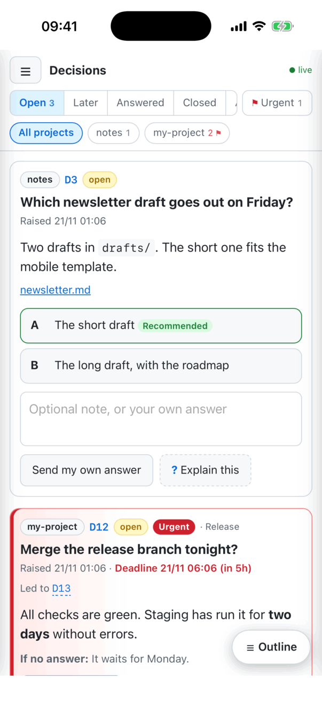
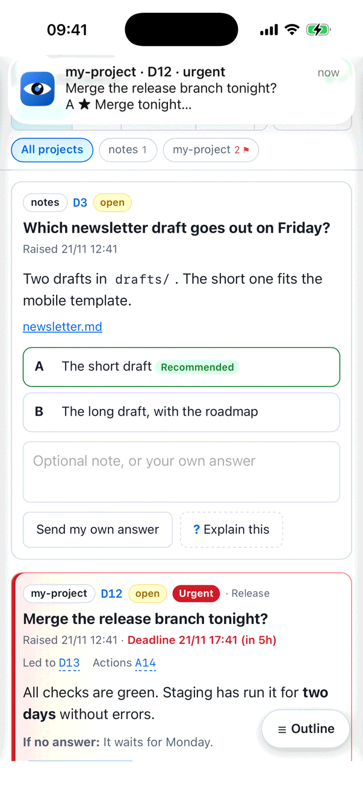
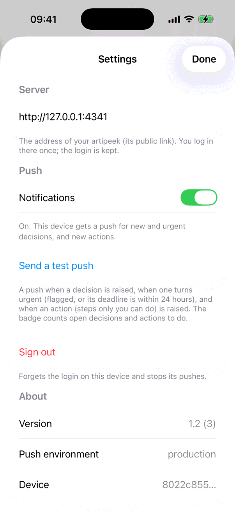
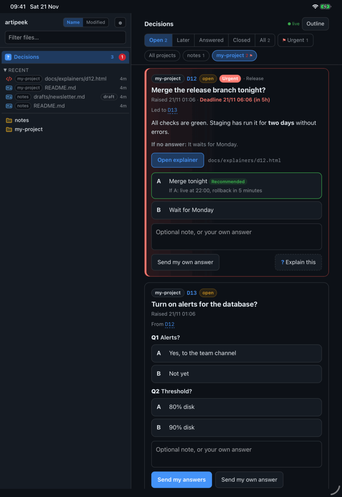
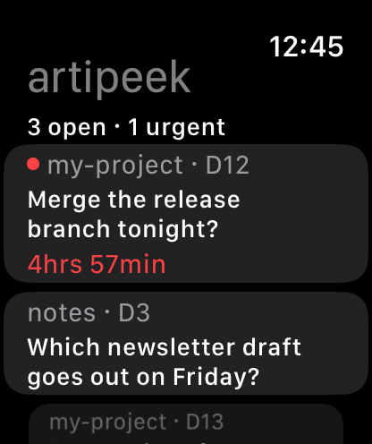
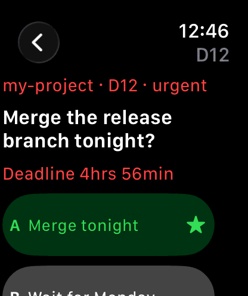
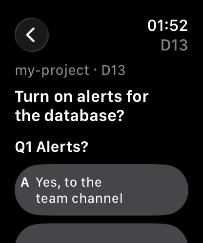

# artipeek for iOS and Apple Watch

A native SwiftUI shell around artipeek's own web UI, plus push notifications for decisions (with answer buttons), and
an Apple Watch app to answer them on the go. The app shows the artipeek
server in a `WKWebView`, so the Decisions tab, the file list, file tabs, answers and explainers are the web version's,
and a new web feature is in the app without an app update.

  
  
  

Screenshots use made-up demo folders.

Native parts:

- **Login**: the Cloudflare Access login page shows inside the app. The login (cookie `CF_Authorization`) is kept in the
  persistent website data store until it runs out; then the login page shows again.
- **Push**: after login, the app asks for permission once and registers its device token with the server
  (`POST /_/push/register`, sent from the web view, so it carries the page's login). A push for a decision that is
  raised, or turns urgent, and for a new action (steps only you can do); a tap opens that decision or action. The badge
  is the number of open decisions plus actions to do (set by each push, and when the app opens). See "iOS app, Apple Watch and push" in the main README for the server side.
- **Settings**: the gear in artipeek's header (the file list, or the home page), or the round gear on the login page:
  server, notifications on/off, a test push, sign out.
- Like Safari for artipeek: inline scripts with the page's nonce, live updates (EventSource), sandboxed HTML frames, the
  answer sheet, downloads (to the share sheet), pull to refresh, dark mode. Links to other sites open in a Safari
  sheet; same-site new windows (e.g. "raw") in a sheet of their own.

- **Answer buttons on a push**: a decision with one question and up to 4 options shows them as buttons (on the
  iPhone, and on the Apple Watch while the phone is locked). A tap saves the answer in the background, with the login
  copied from the web view to the Keychain, and a short "Saved: D4 → A" notification follows. **Reply…** takes a typed,
  dictated or scribbled answer. `ArtipeekNotify` (a notification service extension) puts the option labels on the
  buttons when the values aren't a usual set (A/B, A/B/C, A/B/C/D, Y/N have fixed letter buttons).
- **On an action's push**: **Ask the agent to do it…** (an optional note, then Send) asks the agent in the background,
  as the Actions tab's button does; an "Asked the agent" notification follows. **Open** opens the action.

## Apple Watch

  
  
  

`ArtipeekWatch` is embedded in the iPhone app and installs on the paired Watch (Watch app → artipeek → Install, or
automatically).

- Open decisions, urgent first, with the time left. Tap one: the context, the options as buttons (the recommended one
  green, with a star), one pick per question when there are several, or **Answer in words**. Every answer asks
  "Send A?" first, then saves and goes back to the list.
- Below them the actions to do (urgent first; ticked steps as 2/4), then those with the agent. Tap one: its steps with
  their states (ticked, the agent is checking, verified, verify skipped) and commands in full, to read. Tap a step to
  tick or untick it, or **All done** / **Ask the agent to do it** (an optional note first); each asks first. A server
  from before actions shows decisions only.
- The login: the iPhone app sends it (the Access cookie, over WatchConnectivity) after you log in there, and again when
  it changes. The Watch then talks to the server itself, over Wi-Fi or cellular, also with the phone away. Sign out on
  the iPhone signs the Watch out too. When the login runs out, open artipeek on the iPhone.
- Complication (`ArtipeekWatchWidgets`): open decisions + actions to do (the badge rule) and urgent counts (circular,
  corner, inline), or "2 decisions · 1 action", the urgent count and the first urgent item (rectangular). It refreshes every 15 minutes and whenever the Watch app does.
- The Watch app and the complication share the login through a keychain group of the team
  (`<team>.<bundle id>.watch`); no App Group needed.

No analytics, no third-party code.

## Build

Needs Xcode 26 (iOS 17 or later on the phone), [XcodeGen](https://github.com/yonaskolb/XcodeGen) and
[fastlane](https://fastlane.tools) (`brew install xcodegen fastlane`).

1. `cp Config/Local.xcconfig.example Config/Local.xcconfig` and set your team id, bundle id and server host.
   This file is gitignored; it is the only place they live (fastlane reads them from it).
2. `cp fastlane/.env.example fastlane/.env` and set an App Store Connect API key (Admin role, for cloud signing).
3. `xcodegen generate` makes `Artipeek.xcodeproj` (not tracked; fastlane regenerates it before every build).
4. The server: `push.apns` in artipeek's config, with an APNs key of the same team (see the main README).

The app icon is artipeek's `assets/icon.svg`: `scripts/make-icon.sh` renders it.

## fastlane lanes (run in `ios/`)

| Lane | What it does |
|---|---|
| `fastlane beta` | TestFlight: checks the App Store Connect app exists, regenerates the project, build number = latest TestFlight build + 1, archives and exports with automatic cloud signing, uploads. `changelog:"…"` sets What to Test (and waits for processing). |
| `fastlane device` | Development build installed and started on an iPhone over the network (`xcrun devicectl`; `device_name:"…"` or `device_id:"…"`). It registers as a `sandbox` push token. |
| `fastlane test` | Unit tests on a simulator. |
| `fastlane testers` | Makes sure the app's internal TestFlight group exists (every build) and adds `TESTFLIGHT_TESTERS` from `fastlane/.env`. Apple refuses the API for someone who is already an email-invited tester of another app: then add them once in App Store Connect (TestFlight → Internal → Testers → +). `beta` runs it when the variable is set. |
| `fastlane app_id` | Registers the App IDs in the developer portal, if missing: the app (with Push Notifications), `.notify`, `.watchkitapp`, `.watchkitapp.widgets`. |
| `fastlane app_record` | Checks the App Store Connect app record. Apple lets only an Apple ID login create it (App Store Connect → Apps → + → New App, with the bundle id); the API key can't. |

The first upload also needs the app record; after that, `fastlane beta` alone. Internal testers of the team see a new
build in the TestFlight app once it has been processed (a few minutes).

## Push environments

A development build (`fastlane device`, Xcode) gets an APNs **sandbox** token; TestFlight and App Store builds get
**production** tokens. The app tells the server which (from its embedded provisioning profile), and the server sends
each push to that token's environment.

## Development

DEBUG builds take two launch arguments: `-openPath /r/<folder>/decisions#d:<folder>:<id>` opens a page as a tapped push
would, `-showSettings 1` opens the settings. `-serverURL http://127.0.0.1:4321` points a simulator at a local server
(push registration is refused there: it needs a login or an answer device, like answers). The Watch app takes
`-serverURL` too (instead of the iPhone's login; point it at a local proxy that adds an Access token),
`-openDecision <folder>/<id>`, and `-autoAnswer A` (sends that answer on the opened decision), `-openAction
<folder>/<id>` and `-autoAction tick:2` (or `untick:2`, `all`, `agent`) on the opened action.
